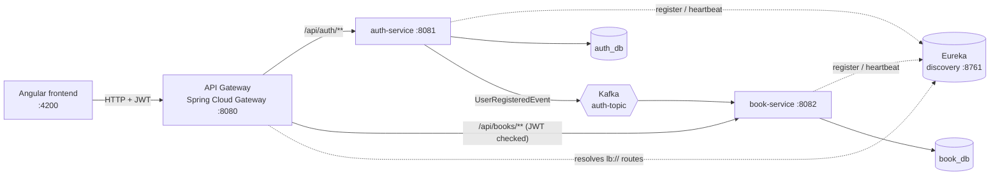

# Library System: Event-Driven Microservices

A library management backend built as a set of Spring Boot microservices behind an API gateway, with service discovery, JWT authentication, asynchronous communication over Apache Kafka, and an Angular frontend. The whole stack starts with one `docker compose up`.


## Architecture



| Service | Port | Responsibility |
|---|---|---|
| `api-gateway` | 8080 | Single entry point. Routes by path through Eureka (`lb://`) and runs a custom `AuthFilter` that validates the JWT before any `/api/books/**` request reaches the book service. |
| `auth-service` | 8081 | Registration and login. BCrypt-hashes passwords, issues signed JWTs (24h expiry), and publishes a `UserRegisteredEvent` to Kafka. Owns `auth_db`. |
| `book-service` | 8082 | Book catalogue: CRUD, filtering by author or genre, counts. Consumes `auth-topic` to keep a local `UserRecord` per registered user. Owns `book_db`. |
| `eureka-server` | 8761 | Service registry used by the gateway for load-balanced routing. |
| `library-frontend` | 4200 | Angular 21 client with register, login and book pages, and an HTTP interceptor that attaches the token. |

### Design decisions
- **Database per service.** `auth_db` and `book_db` live on one Postgres instance but are never shared across services. Cross-service data moves through events, not joins.
- **Event-driven user sync.** When a user registers, `auth-service` publishes to `auth-topic` and `book-service` consumes it, so the book service never calls the auth service synchronously.
- **Authentication at the edge.** The gateway verifies the JWT once. Downstream services are stateless and not exposed outside the Docker network.
- **Inheritance-mapped domain model.** `Book` is the base entity (`JOINED` inheritance) with `WrittenBook`, `EBook`, `PrintedBook` and `AudioBook` subtypes.
- **Externalised configuration.** Secrets and credentials come from environment variables and `.env`, never from source.

## Getting started

**Prerequisites:** JDK 21, Docker with Compose, and Node.js 20.19+ for the frontend.

```bash
# 1. Configure secrets
cp .env.example .env
#    set DB_PASSWORD, and generate a signing key:  openssl rand -base64 48

# 2. Build the service jars (the Dockerfiles copy the prebuilt jars)
./mvnw clean package -DskipTests

# 3. Start Kafka, Postgres, Eureka, the services and the gateway
docker compose up --build
```

The API is then available at `http://localhost:8080`.

```bash
# 4. (optional) Run the frontend
cd library-frontend
npm install
npm start          # http://localhost:4200, proxies /api to the gateway
```

> `JWT_SECRET` must be a **Base64-encoded** value of at least 32 bytes, because the services decode it before signing and verifying tokens.

## API

All requests go through the gateway on port 8080.

**Auth** (public)

| Method | Endpoint | Description |
|---|---|---|
| `POST` | `/api/auth/register` | Create a user and receive a JWT |
| `POST` | `/api/auth/login` | Authenticate and receive a JWT |

**Books** (require `Authorization: Bearer <token>`)

| Method | Endpoint | Description |
|---|---|---|
| `GET` | `/api/books` | List all books |
| `GET` | `/api/books/{ISBN}` | Get one book |
| `GET` | `/api/books/filter-author/{author}` | Filter by author |
| `GET` | `/api/books/filter-genre/{genre}` | Filter by genre |
| `GET` | `/api/books/count` | Total number of books |
| `GET` | `/api/books/count-author/{author}` | Books by an author |
| `POST` | `/api/books?ISBN=&author=&title=&genre=` | Add a book |
| `POST` | `/api/books/auto` | Seed sample books |
| `DELETE` | `/api/books/{ISBN}` | Remove a book |

## Tech stack

**Backend:** Java 21, Spring Boot 3.4, Spring Web, Spring Data JPA, Spring Security, Spring Cloud Gateway, Netflix Eureka, Bean Validation, Lombok
**Messaging:** Apache Kafka (KRaft mode, no ZooKeeper), Spring Kafka with JSON serialisation
**Data:** PostgreSQL, Hibernate/JPA, Liquibase (monolith baseline)
**Security:** JWT (jjwt, HS256)
**Frontend:** Angular 21, TypeScript, RxJS
**Infra:** Docker, Docker Compose with health-checked startup ordering, Maven multi-module build

## Project structure

```
.
├── api-gateway/        # Spring Cloud Gateway + JWT filter
├── auth-service/       # registration, login, JWT issuing, Kafka producer
├── book-service/       # catalogue API, Kafka consumer
├── eureka-server/      # service discovery
├── library-frontend/   # Angular client
├── src/                # early monolithic version the services were extracted from
├── docker-compose.yml  # full local stack
└── .env.example        # required environment variables
```

## Known limitations and next steps
- `book-service` trusts the gateway and permits all requests, so it must stay on the private Docker network. Defence in depth would add token validation in each service.
- Roles (`ROLE_USER`, `ROLE_ADMIN`) are modelled and propagated, but endpoint-level role enforcement is not wired up yet.
- The frontend keeps the JWT in `localStorage`. Moving to an `HttpOnly` cookie would reduce XSS exposure.
- The backend services have no automated tests yet. Integration tests with Testcontainers (Postgres and Kafka) are the logical next step.
